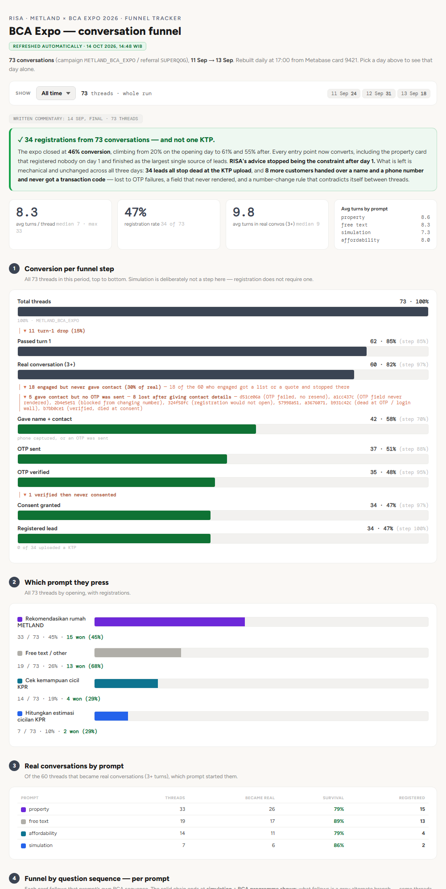
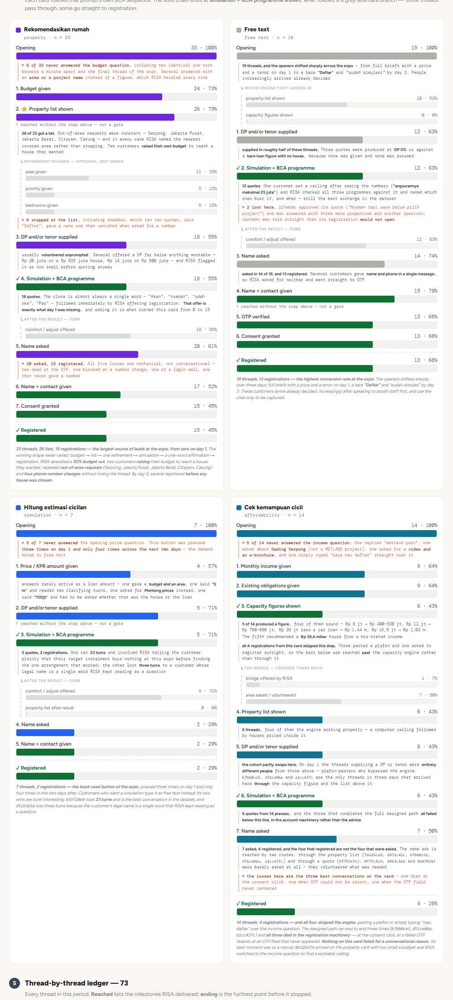
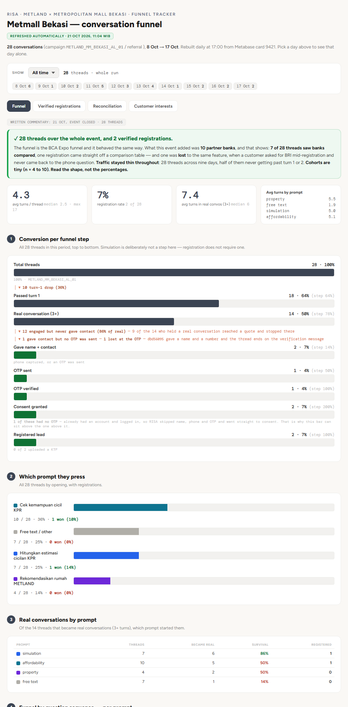

# BCA Expo (11 to 13 Sep 2026) and Metmall Bekasi (8 to 17 Oct 2026)

**Role:** Data Analyst. Built the funnel dashboard.  
**Part of:** [RISA 2.0 iterations](risa-2-iterations.md). Follows the [Danantara Expo](danantara-expo.md).  
**Goal:** Reuse the expo funnel for a single-bank event, adapt it where the BCA flow differs, and read what changed over three days.  
**Event:** BCA Expo 2026, METLAND booth, one bank partner (BCA). 73 conversations, 11 to 13 Sep 2026. The dashboard was rebuilt automatically from a Metabase export and carries hand-written commentary dated 14 Sep.  

> The thread ledger and per-thread notes in the source dashboard include customer-entered details and are not reproduced here. Thread IDs appear only as short prefixes.

## The result

**73 conversations, 34 registrations (47%), and not one KTP upload.**

| Funnel step | Threads | Share of 73 |
|---|---|---|
| Total threads | 73 | 100% |
| Passed turn 1 | 62 | 85% |
| Real conversation (3+ turns) | 60 | 82% |
| Gave name + contact | 42 | 58% |
| OTP sent | 37 | 51% |
| OTP verified | 35 | 48% |
| Consent granted | 34 | 47% |
| Registered lead | 34 | 47% |

- **Conversion climbed across the event, from 20% on day 1 to 61% and 55% on days 2 and 3.** Threads per day were 24, 31 and 18.
- **Every entry point eventually converted,** including the property card, which registered nobody on day 1 and finished as the largest single source of leads (15 of 33).
- **What was left was mechanical, and unchanged across all three days.** All 34 leads stopped at KTP upload, and 8 more customers gave a name and phone number and never got a transaction code. The causes listed were OTP failures with no resend, an OTP field that never rendered, a registration that would not open, a login wall, and a number-change rule that contradicted itself between threads.

The headline says 47% in the tiles and "46%" in the written commentary. 34 of 73 is 46.6%, so both are roundings of the same number.

## By entry prompt

| Opening | Threads | Real conversations | Registered |
|---|---|---|---|
| Rekomendasikan rumah METLAND (property) | 33 | 26 | 15 (45%) |
| Free text | 19 | 17 | 13 (68%) |
| Cek kemampuan cicil (affordability) | 14 | 11 | 4 (29%) |
| Hitungkan estimasi cicilan (simulation) | 7 | 6 | 2 (29%) |

- **Property (15 of 33).** The winning shape never varied: budget, property list, one refinement, simulation, a one-word affirmation ("aman", "nyaman", "pas"), then registration. RISA absorbed a 50% budget cut, two customers raising their own budget to reach a house, repeated out-of-area requests (it named the nearest covered area every time) and four phone-number changes without losing the thread. By day 3, several registered before any house was chosen.
- **Free text (13 of 19, the best conversion).** Openers shifted from full briefs with a price and tenor on day 1 to a bare "Daftar" or "sudah simulasi" by day 3. Customers increasingly arrived already decided, often after talking to booth staff first, and used the chat only to be captured.
- **Simulation (2 of 7).** The least-used button: pressed three times on day 1 and four times across the next two days. Customers who want a simulation type it as free text. Its answers rarely arrive as a clean loan amount (one gave a budget and area, one said "5 m", one said "700jt" and had to be asked whether it was the house or the loan).
- **Affordability (4 of 14).** The engine ran properly in about four threads, a computed ceiling followed by homes priced inside it. **All four registrations skipped the engine**: they pasted a plafond or typed "mau daftar" over the income question. The designed path ran end to end three times, and all three died in the registration machinery (at the consent click, at a failed OTP resend, at an OTP field that never appeared). Nothing on that card failed for a conversational reason.

## What changed between the Danantara dashboard and this one

The detector set was reused, but a single-bank event changed several decisions. These were decided against test conversations pulled a few days before the event. The final dashboard then ran on real traffic using that design.

- **Population.** The first test export had no campaign ID, so threads were separated by RISA's own greeting ("BCA Expo 2026", programmes tagged `[BCA EXPO 9/26]`), excluding the Danantara greeting and a loan-programme finder that shared the same tool. Real traffic carried a campaign tag and removed the problem. Free-text openers can be character-identical across populations, so opener text alone is never a filter.
- **"DP and/or tenor supplied", not "DP + tenor".** BCA has a short simulation path where RISA computes a result from amount and tenor alone and asks for DP afterwards. Requiring both would score that thread zero while a result sat below it, which would make the funnel rise. The step is defined as "enough supplied for RISA to compute".
- **A comfort-check milestone and a fork.** After a simulation RISA always asked whether the installment felt comfortable, in 12 of 12 test threads that reached a result. That became its own milestone, and the chain stops at "simulation and BCA programme shown". What follows is a grey fork: straight to name asked (5 of 12), property list shown after the result (4 of 12), or the thread ends (3 of 12). A solid bar there would imply a sequence that does not exist.
- **Affordability changed shape.** Budget is never asked on this path (capacity replaces it), "which area?" became a grey sub-row because the bridge to property is crossed three different ways (RISA offers it, RISA asks, or the customer volunteers the area), and the tail from "property list shown" onward is identical to the simulation card's.
- **New states with no Danantara equivalent:** a login wall (the phone already has an account), a "follow-up saved" terminal state, a customer-app handoff after KTP, and refusals for off-bank and off-developer requests.
- **Test-data quarantine.** Once real expo data existed, nothing from the test set could appear. Per-thread notes were keyed to thread IDs and fell away on their own, and the aggregate commentary carried the days it described and was dropped when those days did not match the incoming data.

## What the event showed about the product

- **A registration offer after the simulation was the day-1 gap.** The dashboard credits adding it with turning the property card from 0 registrations to 15: the close is almost always a single affirmation, followed immediately by RISA offering registration.
- **People type at the OTP widget.** Customers typed the code into the chat, typed "Kirim ulang OTP" as a message, and typed "Verifikasi" as a message, in one thread across six turns. The same pattern appeared at Danantara. It remained a top mechanical leak.
- **Boundaries were tested and held.** Customers asked for areas outside the expo, other banks, and other projects, and RISA declined cleanly each time.
- **Data gaps were a pre-event risk.** About 56% of test threads hit missing fields ("belum tersedia", "menunggu konfirmasi", handover date blank), flagged for fixing before the event.
- **Customers asked for photos.** RISA has none and deferred to the booth; two customers asked in two days.
- **One failure mode was a name collision.** A customer whose legal name is a single word that is also a common question word looped RISA for three turns.

## Metmall Bekasi (8 to 17 Oct 2026)

The same funnel ran at a shopping-mall event with **10 partner banks**, so bank comparison appeared in the flow.

- **28 threads over nine days, 2 verified registrations (7%).** Half never got past turn 1 or 2, and cohorts per prompt were 4 to 10, so the dashboard says to read the shape and not the percentages.
- **Bank comparison was used and cut both ways.** 7 of 28 threads saw banks compared. One registration came directly off a comparison table, and one was lost when a customer asked for another bank mid-registration and never returned to the phone question.
- **A login shortcut explains an odd bar.** One customer already had an account, so RISA skipped name, phone and OTP and went straight to consent. That is why the consent bar can sit above the OTP bar.
- **Both registrations stopped at KTP,** as at the other events.

## What I took away

- **The same product can look very different by event.** Conversion was 30% at Danantara, 47% at BCA and 7% at Metmall, with different audiences, different banks and, at BCA, a day-1 fix. I would not compare them as if they were an experiment.
- **Within an event, the fix that mattered was small.** The registration offer after the simulation turned a card from 0 to 15. After day 1, what was left was OTP, consent and account handling, not the conversation.
- **Design the funnel for the flow you have.** Forks, grey side-branches and a step defined as "enough to compute" kept the bars from rising where the flow did not require a sequence.
- **Every BCA registration ended at the same point.** 0 of 34 uploaded a KTP, so for a lead to become an application, something after the chat has to carry it.

<!-- NOTE: I used the final (14 Oct) rebuild of the BCA dashboard, which replaced the test-data version. The "56% of test threads" data-gap figure and the "12 of 12" comfort-check figure come from the pre-event test analysis, not from the final data. -->
