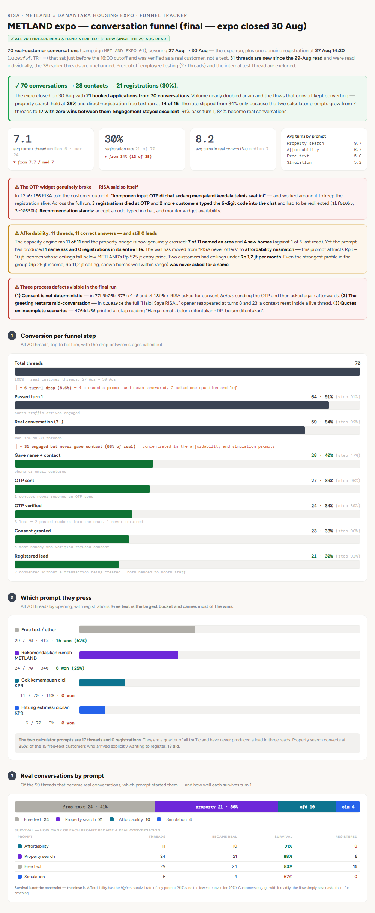
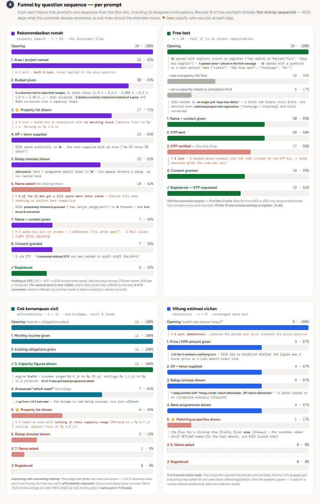

# Danantara Housing Expo (27 to 30 Aug 2026): RISA at the METLAND Booth

**Role:** Data Analyst. Built the funnel dashboard.  
**Part of:** [RISA 2.0 iterations](risa-2-iterations.md)  
**Goal:** Read RISA's first live public showcase honestly: how many conversations, how many registrations, what blocked the rest, and what the CS team saw at the booth that the logs cannot show.  
**Event:** Danantara Housing Expo, NICE PIK 2, 27 to 30 Aug 2026 (4 days). RISA ran at the METLAND booth with five bank partners (Mandiri, BNI, BRI, BSI, BTN).  
**Sources:** a funnel dashboard built from the conversation export (70 threads, all read and hand-verified), and the CS team's observation report. The CS report is input to the Growth team; its registration mechanics were to be checked against the conversation records.  

> Customer names, phone numbers and transaction codes from the CS report and the thread ledger are not reproduced here.

## The result

**70 real conversations, 28 contacts, 21 registrations (30%).**

| Funnel step | Threads | Share of 70 |
|---|---|---|
| Total threads | 70 | 100% |
| Passed turn 1 | 64 | 91% |
| Real conversation (3+ turns) | 59 | 84% |
| Gave name + contact | 28 | 40% |
| OTP sent | 27 | 39% |
| OTP verified | 24 | 34% |
| Consent granted | 23 | 33% |
| Registered lead | 21 | 30% |

- **Engagement was not the problem.** 91% got past turn 1 and 84% became real conversations; booth traffic arrives engaged.
- **The wall was the close.** 31 engaged customers (53% of real conversations) never gave contact, concentrated in the affordability and simulation prompts.
- **Once someone verified, almost nobody refused:** 24 verified, 23 consented, 21 registered.

The CS report, written independently from booth observation and the system export, reaches the same count: **21 transactions in the system, every one still at the onboarding status, none yet with a KTP uploaded.**

## Which prompt people pressed

| Opening | Threads | Registered |
|---|---|---|
| Free text | 29 (41%) | 15 (52%) |
| "Rekomendasikan rumah METLAND" (property search) | 24 (34%) | 6 (25%) |
| "Cek kemampuan cicil KPR" (affordability) | 11 (16%) | 0 |
| "Hitung estimasi cicilan KPR" (simulation) | 6 (9%) | 0 |

- **Free text carried the wins.** Of 16 free-text customers who arrived explicitly wanting to register, 14 did. A third of that bucket now browsed units first.
- **The two calculator buttons produced no leads in three successive reads of the dashboard** (17 threads, 0 registrations), and were a quarter of all traffic.
- **Survival is not the constraint, the close is.** Affordability had the highest survival (91% became real conversations) and the lowest conversion. Customers engaged readily; the flow simply never asked them for anything.

## Per-prompt funnels

Each card follows that prompt's own sequence from the flow document, with grey side-branches for routes some threads take and some skip, and a reason on every drop.

**Property search (24 threads, 6 registered, 25%).** Area named in 22, budget in 20, a property list shown in 17, DP and tenor supplied in 15, a full simulation in 15, name asked in 10, contact given in 7, registered 6. Three findings came from reading the threads:

- **A proactive offer was the clearest lever.** Where RISA offered to proceed ("mau lanjut pengajuan?"), **6 of 8 threads converted.** Where it offered only another tweak or another bank comparison, almost none did. 5 of the 15 who got a full quote were never asked for contact at all.
- **Six customers had to raise their budget to reach stock** (for example Rp 1.9 billion up to Rp 3.2 billion), and most accepted.
- **Three asked for an area and budget with no matching stock** (Jakarta Timur at Rp 1 billion, Menteng at Rp 1.9 billion).

**Free text (29 threads, 15 registered).** 16 opened with explicit intent to register, and 7 pasted name and phone in the first message. The only drop in the registration chain was OTP verification: 3 lost, 2 of them because they **pasted their phone number into the chat instead of the OTP box.**

**Affordability (11 threads, 0 registered).** The capacity engine ran 11 of 11 times and the bridge to property worked this time (7 of 11 named an area, 4 saw homes, against 1 of 5 at the previous read). Yet the prompt produced one name ask and no registration in its whole life. The wall moved from "RISA never offers" to **affordability mismatch**: this prompt attracts Rp 6 to 10 million incomes whose borrowing ceilings fall below METLAND's Rp 525 million entry price.

**Simulation (6 threads, 0 registered).** Two pressed it and never answered the price question; 3 of the 4 who engaged needed a clarifying turn to establish whether the figure was a house price or a loan amount.

## Defects and process problems

From the dashboard:

- **The OTP widget broke.** In one thread RISA told the customer outright that the OTP input component was having technical problems, and worked around it to keep the registration alive. Across the run, 3 registrations died at OTP and 2 more customers typed the six-digit code into the chat and had to be redirected. Recommendation: accept a code typed in chat, and monitor widget availability.
- **Consent was not deterministic.** In three threads RISA asked for consent before sending the OTP and then asked again afterwards.
- **The greeting restarted mid-conversation** in one thread (a context reset inside a live conversation, at turns 8 and 23).
- **A quote was issued on an incomplete scenario** ("Harga rumah: belum ditentukan, DP: belum ditentukan").

From the CS team's defect register, the findings were mostly **session and state management, not conversation quality**:

| ID | Defect | Severity |
|---|---|---|
| E1 | **Consent fired without OTP** on a shared device, reproduced three times in one room, registering a customer against a number the system treated as verified | Critical |
| E2 | A phone number could not be changed in an existing room (the system demanded OTP against the first number) | Critical |
| E3 | Customers who hit their usage limit could not type to continue | High |
| E4 | Retrieving the OTP cost the customer their conversation history | High |
| E5 | Calculation text leaked into replies (the step-up installment ran as a prompt workaround because the lender shell had no step-up tool) | High |
| E6 | Some browsers and phones could not load RISA | Medium |

The CS report calls out that four of the six defects (E1 to E4) are the same class of problem: the product cannot hold a customer's state across a step. Its hypothesis for engineering is to bind identity to the registration attempt, not to the room. E1 carries compliance weight, because a record was created carrying an approval the customer may not have given.

## What the booth showed that logs cannot

- **Of 27 booth interactions on days 3 and 4, 10 registered, and only 3 of the other 17 are attributable to the AI.** 8 wanted a human or their sales rep was absent, 4 wanted a site visit first, 2 were not in market, 2 abandoned mid-flow and 1 could not open the AI on their phone.
- **Day 1 was mostly bankers, not buyers.** Real customer volume arrived on day 3 (Saturday): registrations by day were 4, 6, 10 and 1.
- **RISA worked as a self-service channel.** Customers scanned from the TV screen and from the printed brochure and continued on their own phones, unassisted.
- **What customers praised:** that RISA "talks like a sales agent rather than a form", and the installment simulation, which was the most-praised feature of the event.
- **Positioning the CS team recommended:** AI as a tool the sales team uses, not a replacement for the sales team.
- **A content backlog from real questions:** location anchoring, building and land area, DP needed for a target installment (reverse simulation), kavling, early settlement, freelance KPR eligibility, access and transit. The cheapest win named was a prompt change to mention access and transit in the same message as a recommendation.
- **A documented human sales ladder to measure RISA against.** RISA did steps 2 to 4 well (location, budget, options, DP and installment), was partial on bedroom and area criteria, weak on the side-by-side comparison when a customer is over budget, and only covered access, facilities and urgency when asked.

## What I took away

- **Delivery was strong; the registration machinery was weak.** The conversation layer worked at a booth (91% passed turn 1, 84% real conversations), and what lost customers was OTP, consent and session handling.
- **Read the logs and the booth together.** The logs said 0 leads from the calculator buttons; only the booth notes explained that customers wanted a person, not an AI, and that several never got one.
- **Know the constraints before the event.** Several of the most-reported complaints traced to limits accepted beforehand (property search tool delivered at the weekend, no step-up calculation tool, photos and links deliberately off). In the CS report's words, the expo did not reveal them, it priced them.
- **Hand reading found the lever.** The 6-of-8 conversion on a proactive "mau lanjut pengajuan?" offer was counted by reading transcripts, not by a detector.

<!-- NOTE: the dashboard gives two versions of the free-text register-intent figure: "14 of 16" on the free-text card and "13 of 15" in the prompt summary. I used the card (14 of 16). -->
<!-- NOTE: the CS report said three customers seen registering at the booth were missing from the CRM and were "with the data analyst". I did not see the result of that check, so I left it out. -->
