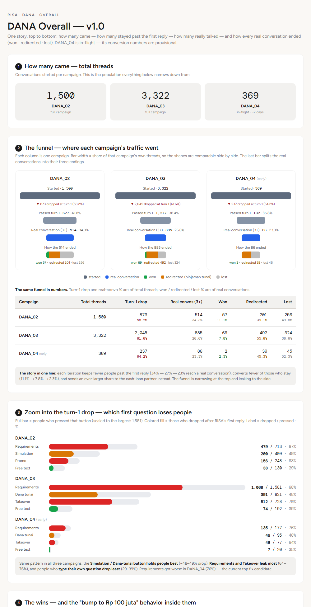
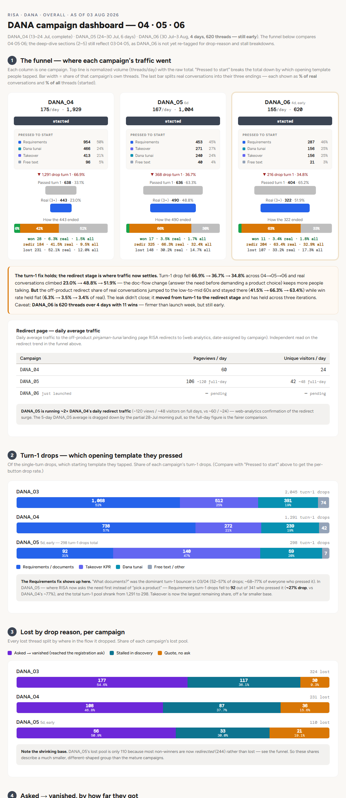
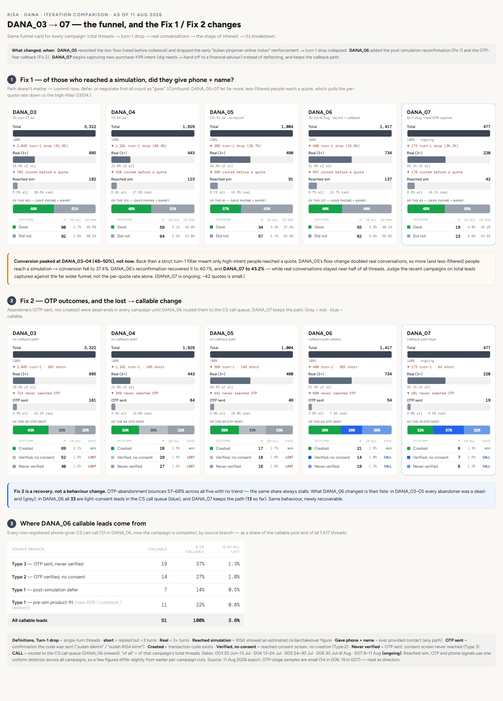
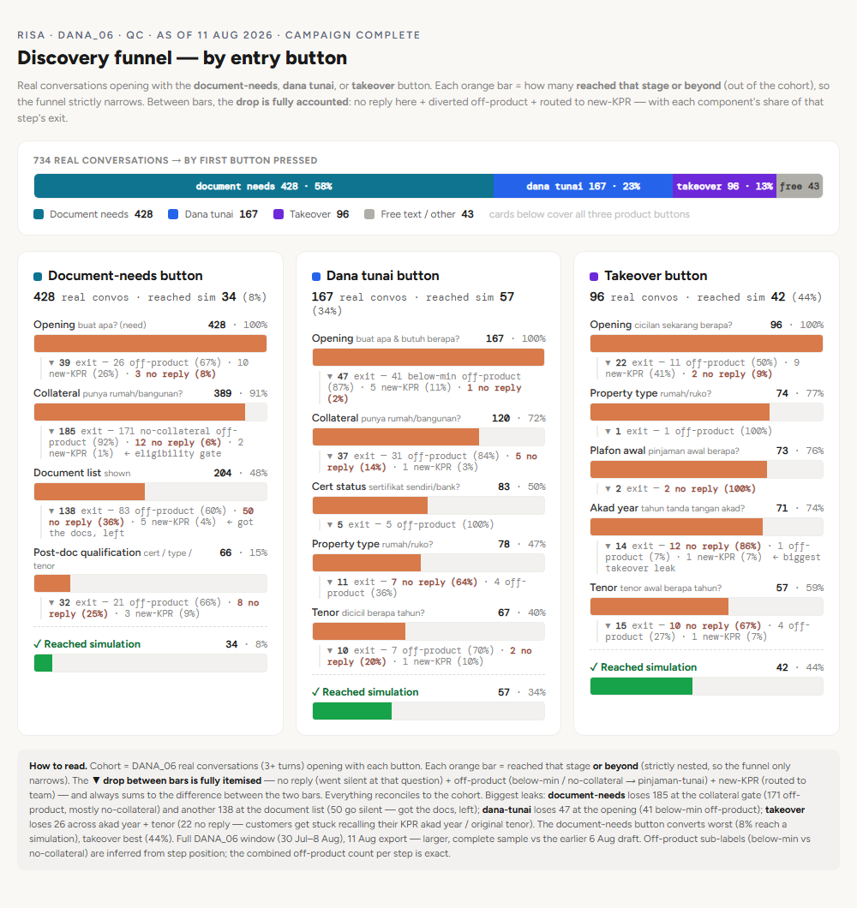
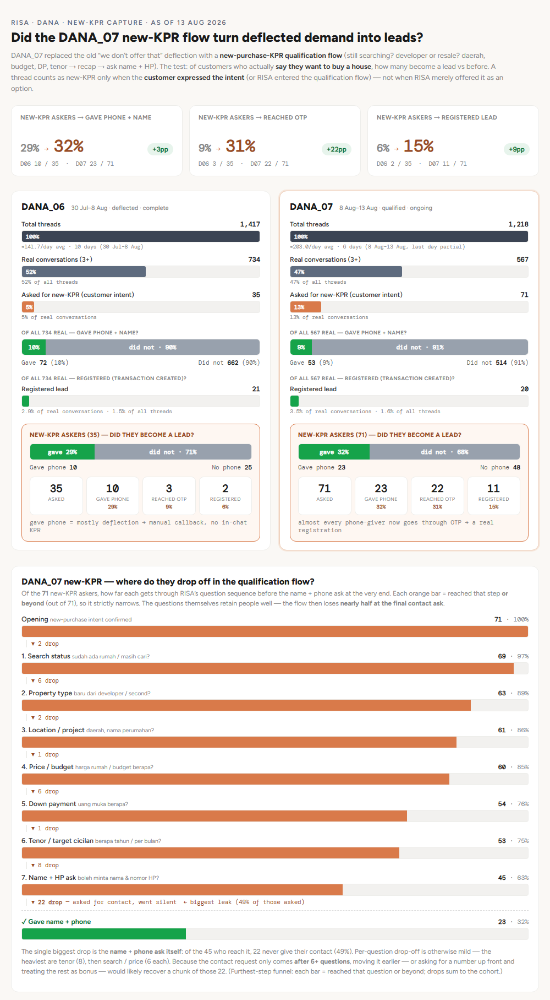
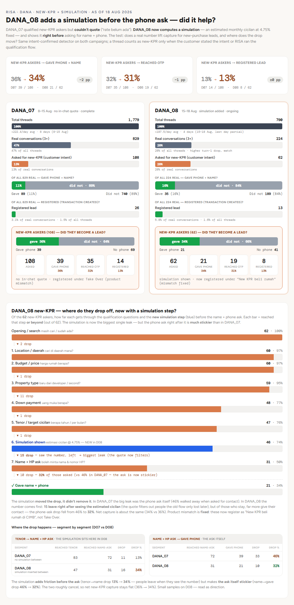
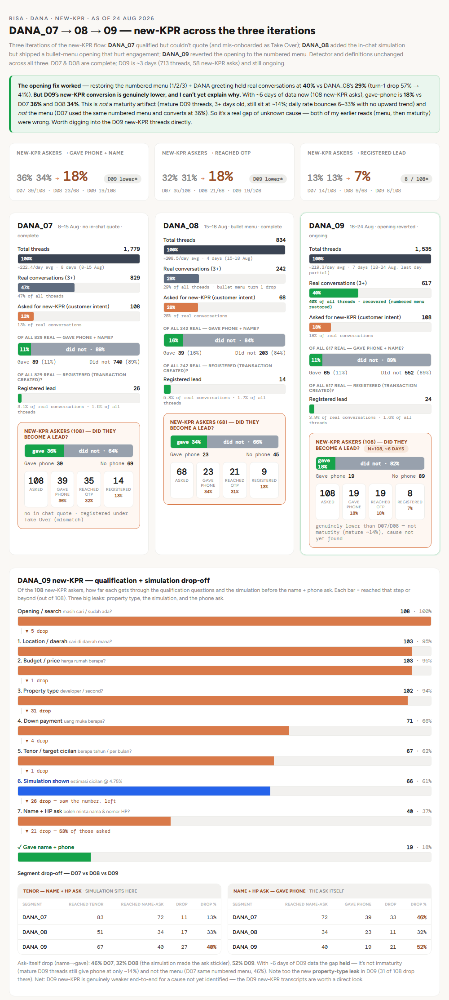
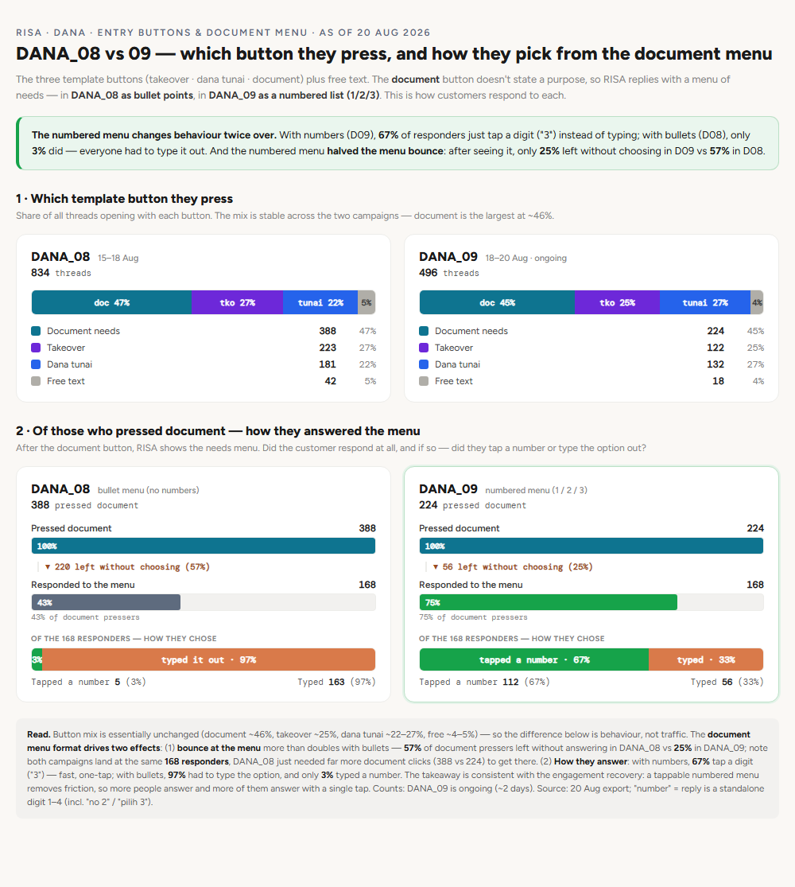
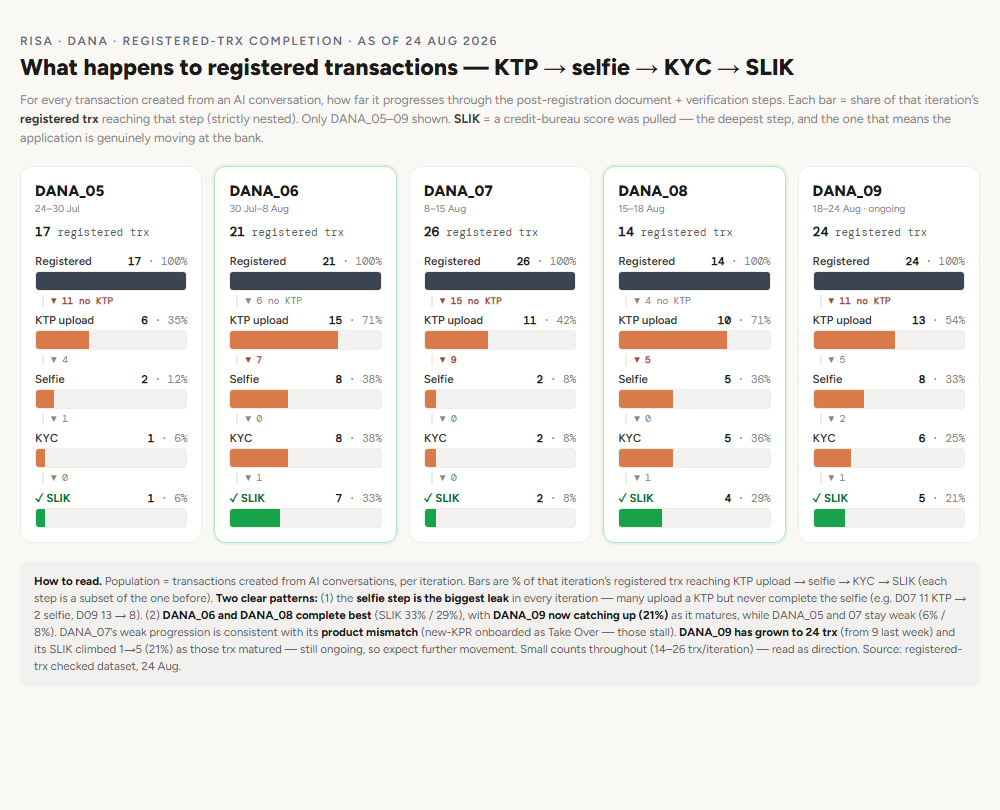
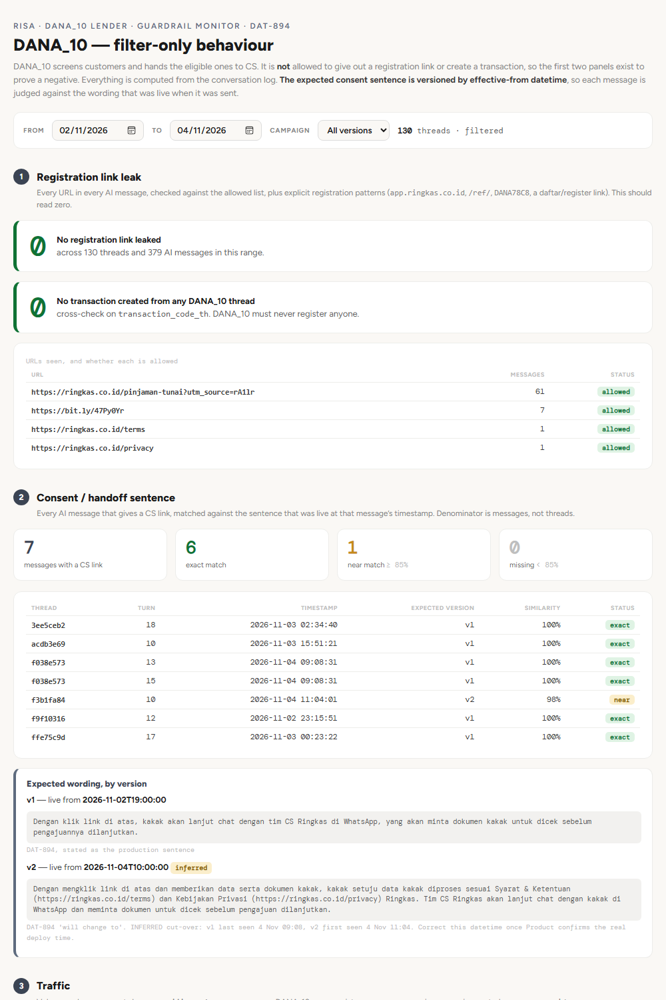

# RISA 2.0 Iterations: Measuring and Improving an AI Sales Agent, Campaign by Campaign

**Role:** Data Analyst. Built the evaluation dashboards and proposed the hypotheses for each iteration.  
**Goal:** Turn RISA's raw chat logs into a repeatable weekly evaluation, so each prompt change could be treated as a hypothesis, tested on the next campaign, and judged on numbers.  
**Tools:** Metabase (conversation export), rule-based Python detectors, self-contained HTML dashboards built with Claude Code, a Google Sheet for CS follow-up. The Notion page for the first iteration (DANA_02) is the source for that plan.  
**Period:** Jun to Nov 2026  

**Contents**
1. [What RISA is and how the evaluation worked](#1-what-risa-is-and-how-the-evaluation-worked)
2. [The method](#2-the-method)
3. [The DANA campaigns, iteration by iteration](#3-the-dana-campaigns-iteration-by-iteration)
4. [DANA_10: a different job, a guardrail monitor](#4-dana_10-a-different-job-a-guardrail-monitor)
5. [Event deployments](#5-event-deployments): [Danantara Expo](danantara-expo.md) and [BCA Expo](bca-expo.md)
6. [Other lenders: JULO and Pandai Gadai](#6-other-lenders-julo-and-pandai-gadai)
7. [What I took away](#what-i-took-away)

> Private repo: these dashboards contain real conversation data. Thread IDs are shown only as short prefixes, and customer names and phone numbers are not reproduced.

---

## 1. What RISA is and how the evaluation worked

RISA is an AI sales agent that talks to prospects in chat. In the DANA campaigns it lives inside the DANA app and sells CIMB property-backed loans: **takeover** of an existing KPR (home loan), and **cash loans secured on property**. A customer picks one of three suggested buttons (or types freely), RISA qualifies them, runs a simulation, and tries to register them: name, phone, OTP, consent, then a transaction is created.

Each campaign is a new prompt or flow version, run for roughly a week to three weeks. The evaluation loop, as written down for DANA_02, was weekly:

1. Summarise the week's signal and feedback.
2. Write a hypothesis (Monday).
3. Stakeholders review the hypothesis (Monday afternoon) and approve it (Tuesday).
4. The prompt owner updates the prompt and tests it in a test environment (Tuesday).
5. Final approval (Wednesday or Thursday).
6. Decide how many threads and days are needed to read the result.

Every change was written as **"IF we change X, THEN metric Y moves from A to B, BECAUSE …"**, with the signal to watch named in advance.

---

## 2. The method

The dashboards follow one set of rules. They came from repeated corrections, and several were learned the hard way.

- **Unit of analysis.** One thread is one customer conversation. One export row is one turn: the customer's message plus the AI reply it triggered. So RISA's question in row *i* is answered (or not) in row *i+1*. That pairing is what makes "which question was pending when they left" detectable.
- **Two kinds of detector.** `M_*` detectors fire when RISA *delivered* something (a property list, a simulation recap). `Q_*` detectors fire when RISA is *asking* for something, and must contain a question word, so a result line like "Tenor: 20 tahun" is not counted as a tenor question. An *offer* never counts as a *result*.
- **Milestone reach, not a strict chain.** Entry buttons share the same few engines (capacity, property match, simulation), entered in different orders, so a bar means "reached this milestone", not "passed through in sequence".
- **A funnel must never appear to go back up.** If a milestone can happen without its apparent parent, it is pulled out of the chain and shown as a grey side-branch.
- **Answered over asked.** A slot that was never asked never counts against the customer. Abandonment is the question that was pending when RISA's last message was sent. If the last message was an *answer*, it is an "engaged exit": they got what they came for.
- **Every drop gets a reason.** Each ▼ line says who was lost and why (no matching stock, never replied, deflected, off-product), read from the transcripts.
- **Validate against ground truth, then by hand.** Every thread with a transaction code must pass every step detector; a won thread failing a step proves a detector gap. Then the drop cohorts are read individually, because the regex pass alone has been wrong by several threads on a single day's data.
- **Wording drifts.** The Notion prompts often paraphrase RISA's real wording ("sesuai ekspektasi" in Notion, "pas sama harapan" in production), and DANA_06 changed the OTP-sent sentence, which silently broke the old detector. Always grep real transcripts before trusting a keyword.

Delivery for the event dashboards was split in three layers with different refresh rules: funnel numbers rebuilt by script, per-thread notes written from reading transcripts, and aggregate commentary written only after a deliberate reading pass, so a nightly job could never publish an unreviewed claim.

---

## 3. The DANA campaigns, iteration by iteration

### The trend

Figures below use the 11 Aug 2026 export with one uniform detector across campaigns, except DANA_02, which comes from an earlier pull. DANA_07 was still running at that pull.

| Campaign | Window | Threads | Turn-1 drop | Real conversations (3+ turns) | Reached a simulation | Of those, gave name + phone |
|---|---|---|---|---|---|---|
| DANA_02 | 11 to 25 Jun | 1,500 | 58.2% | 514 (34.3%) | not comparable | not comparable |
| DANA_03 | 25 Jun to 13 Jul | 3,322 | 61.6% | 885 (26.6%) | 182 (5.5%) | 49.5% |
| DANA_04 | 13 to 24 Jul | 1,929 | 66.9% | 443 (23.0%) | 123 (6.4%) | 48.0% |
| DANA_05 | 24 to 30 Jul | 1,004 | **36.7%** | 490 (**48.8%**) | 91 (9.1%) | 37.4% |
| DANA_06 | 30 Jul to 8 Aug | 1,417 | 33.9% | 734 (51.8%) | 137 (9.7%) | 40.1% |
| DANA_07 | 8 to 11 Aug (ongoing) | 477 | 36.3% | 220 (46.1%) | 42 (8.8%) | 45.2% |

*The first dashboard, v1.0 (DANA_02 to 04): how many came, how many stayed past the first reply, how many really talked, and how each real conversation ended.*

How each campaign's real conversations ended (won, redirected to the unsecured cash-loan partner, or lost), from the dashboards of the time:

| Campaign | Won | Redirected (pinjaman tunai) | Lost |
|---|---|---|---|
| DANA_02 | 57 (11.1%) | 201 (39.1%) | 256 (49.8%) |
| DANA_03 | 69 (7.8%) | 492 (55.6%) | 324 (36.6%) |
| DANA_04 | 28 (6.3%) | 184 (41.5%) | 231 (52.1%) |
| DANA_05 | 17 (3.5%) | 325 (66.3%) | 148 (30.2%) |
| DANA_06 (early, 3 Aug) | 11 (3.4%) | 204 (63.4%) | 107 (33.2%) |

Numbers differ a little between dashboards because campaigns were still running and each pull is a snapshot. Each figure is tagged with its own export date in the source dashboards. DANA_02 to 04 won/redirected/lost come from the earliest dashboard and DANA_04 to 06 from the 3 Aug one, so the redirect share in particular is not strictly like-for-like across that boundary.

### DANA_02: a plan built from the first campaign

DANA_02 was planned from DANA_01's analysis (2 to 7 Jun, 93 sessions). The first read was by entry button:

| Entry point | Sessions | Bounce rate | Conversions |
|---|---|---|---|
| Simulation button | 37 | 35% | 3 |
| Requirements button | 35 | **63%** | 0 |
| Promo button | 11 | **73%** | 0 |
| Free text | 10 | 50% | 0 |

Four changes were proposed, each with an IF / THEN / BECAUSE hypothesis:

1. **Fix the Requirements and Promo replies.** RISA answered the document question in full, the customer was satisfied, and the follow-up routing question sounded optional ("kalau mau…"). The change was a short answer plus one direct pull question. Target: turn-1 bounce from 63% / 73% to below 45%.
2. **Re-engage and refer far-out-of-range users.** 16 of 93 sessions (17%) asked for less than Rp 300M, and 10 stayed below and were rejected with no path forward. The change added a referral link or a Multiguna check. Target: next-step guidance from 3.15 to 3.5 or more.
3. **Fix the post-simulation close.** The follow-up offered two options and the customer went quiet. The change was a single call to action. Target: simulation-to-registration from 45% (9 of 20) to above 60%.
4. **Add post-transaction guidance.** All 4 registered transactions reviewed had incomplete documents after KTP, because nobody told the customer what to do next. The change was a document checklist.

The DANA_02 dashboard shows Requirements and Promo still dropping 67% and 63% of the people who pressed them. The two measures are not necessarily like-for-like (DANA_01 "bounce" vs DANA_02 "turn-1 drop"), so I would not call the target missed, only not visibly met. The big improvement came three campaigns later, from a bigger change.

### DANA_03 and DANA_04: the funnel narrows

Between DANA_02 and 03 the opening buttons changed (the Simulation and Promo buttons were replaced by Dana tunai and Takeover; Requirements stayed). Across 02, 03 and 04 the dashboard found one pattern: **each iteration kept fewer people past the first reply (34%, 27%, 23% reached a real conversation) and converted fewer of those who stayed (11.1%, 7.8%, 2.3%)**, sending a growing share to the cash-loan partner.

The "What documents do I need?" button (Requirements) was the worst leak, dropping 68% in DANA_03 and 76% in DANA_04 of everyone who pressed it.

*The DANA_04 to 06 dashboard. The turn-1 pool shrinks from 1,291 drops in DANA_04 to 298 in DANA_05.*

### DANA_05: the change that moved the funnel

DANA_05 reworked the document flow: **RISA now asks what the customer needs before asking about collateral**, and dropped an early "this is not an instant online loan" reinforcement. The effect was the largest in the whole series:

- Turn-1 drop fell from **66.9% to 36.7%**.
- Real conversations rose from **23.0% to 48.8%**.
- Requirements-button turn-1 drops fell from about 77% to about 27%.

The cost showed up elsewhere: more, less-filtered people now reached a quote, so the per-quote phone capture fell (48% to 37%), and the **off-product redirect share of real conversations jumped from 41.5% to 66.3%** while the win rate held flat. In the dashboard's words, the leak did not close; it moved from turn 1 to the redirect stage.

### DANA_06: the reconfirmation and the callback

DANA_06 added two changes:

- **Fix 1, reconfirmation.** After the simulation RISA asks whether the figure matches expectations ("pas sama harapan?") before pushing for name and phone.
- **Fix 2, manual callback for OTP hesitancy.** If a customer fears or refuses the OTP, RISA offers a callback on the number already on file, takes light consent, asks a preferred call time, and routes the lead to a manual CS queue.

The honest reading, from the dashboards:

- **Fix 1 was a weak positive, within noise.** Silence after a simulation moved from 34.1% to 32.3% on 85 vs 62 simulation threads. Per-quote phone capture recovered from 37.4% to 40.1%.
- **Fix 2 was a recovery, not a behaviour change.** OTP abandonment stayed at 57% to 68% in every campaign with no trend. What changed is the fate of the abandoners: in DANA_03 to 05 every one was a dead end, in DANA_06 **all 33 became callable leads in the CS queue**.

The 51 callable leads in DANA_06 (3.6% of all threads) split into four sources: OTP sent but never verified (19), OTP verified but no consent (14), post-simulation defer (7) and pre-simulation product-fit (11). A daily job appended new non-registered phone-givers to a Google Sheet for the CS team to call, with a type, a preferred call time and a one-line summary, because a lead that CS cannot reach is not a lead.

Where did the real conversations that never simulated go? A step-by-step QC of the 734 real DANA_06 conversations, by first button:

- **Document needs** (428 conversations, only 8% reached a simulation): 185 left at the collateral question, almost all because they had no collateral, and 138 more after the document list (83 off-product, 50 simply went silent after getting their answer).
- **Dana tunai** (167, 34% reached a simulation): 47 left at the opening, mostly below the minimum amount.
- **Takeover** (96, 44% reached a simulation): the biggest leak was the akad-year question, where 12 of 14 who left went silent. Customers get stuck recalling the year they signed their KPR.

Most of the people who never simulated were genuinely off-product (no collateral, or below the minimum) and correctly redirected. The leak was less "RISA losing them" than "the button attracting people it cannot serve".

### DANA_07: capture new-purchase KPR demand instead of deflecting it

DANA_06 revealed a hidden signal: a steady trickle of customers asked for a **new-purchase KPR**, which RISA deflected ("we don't offer that here"). About 25 of them in DANA_06's discovery sample, roughly the same as the 40 who gave a phone number in the same window.

DANA_07 replaced the deflection with a qualification flow (still searching? developer or resale? area, budget, down payment, tenor, a recap, then ask for name and phone). A thread only counts as new-KPR when the customer stated the intent, not when RISA merely offered it.

| New-KPR askers | DANA_06 (deflected) | DANA_07 (qualified) |
|---|---|---|
| Gave phone + name | 10 of 35 (29%) | 23 of 71 (32%) |
| Reached OTP | 3 of 35 (9%) | 22 of 71 (31%) |
| Registered lead | 2 of 35 (6%) | 11 of 71 (15%) |

The result: **raw phone capture barely moved, but the quality of the leads jumped.** In DANA_06 a new-KPR asker who left a number was almost always a manual-callback lead. In DANA_07 nearly every phone-giver went through OTP into a real registration. The biggest leak was the name-and-phone ask itself: of 45 who reached it, 22 never gave contact (49%), because the ask only comes after six questions. The dashboard recommended asking earlier.

### DANA_08: add a simulation before the phone ask

DANA_07 qualified the buyer but could not quote ("rate belum ada"), and it onboarded new-purchase customers into the Take Over product, which would fail at the bank. DANA_08 computed an in-chat estimate (monthly installment at a 4.75% fixed rate) before asking for contact, and registered these customers under the correct new-KPR product.

- **Net capture did not move:** gave phone 36% to 34%, registered 13% to 13%.
- **The drop moved.** The phone ask itself, which lost 46% of people in DANA_07, now lost only 32%: someone who has seen a real number is readier to hand over contact. But a new leak appeared at the simulation (15 of 62 left after seeing the quote), and the tenor-to-ask step went from a 13% to a 34% drop. The two roughly cancelled.
- **A side effect:** DANA_08's real-conversation rate fell to 28% from 47%. The cause was the opening, covered next.

### DANA_09: undo the opening, find a new mystery

DANA_08 had also changed the document-button reply to a **bullet menu**; it hurt engagement. DANA_09 restored the numbered menu (1 / 2 / 3).

- Real conversations recovered to **40%** from 29%, and turn-1 drop fell from 57% to 41%.
- After the document button, **57% left without choosing** with the bullet menu against **25%** with the numbered one.
- With numbers, **67% just tapped a digit**; with bullets only 3% typed a number and the rest had to type the option out.

The engagement fix worked. But DANA_09's new-KPR conversion was lower: gave phone **18%** against 36% and 34%, OTP 18% against 32% and 31%, registered 7% against 13% and 13%. The dashboard rules out two explanations it had offered before: it is not the menu (DANA_07 had the same numbered menu and converted at 36%), and it is not immaturity (threads three or more days old still gave a phone number at about 14%). The drops sat at property type (31 of 108 left there), the simulation (26 left after the quote) and the phone ask (52% walked away, against 32% in DANA_08).

**The cause was not found.** The dashboard's own conclusion is "a real gap of unknown cause", and the next step it names is to read the DANA_09 new-KPR transcripts directly. I am recording it as open instead of inventing an explanation.

### After registration: where the leads go

For every transaction created from a conversation, how far it got through the post-registration steps:

| Iteration | Registered | KTP uploaded | Selfie | KYC | SLIK pulled |
|---|---|---|---|---|---|
| DANA_05 | 17 | 35% | 12% | 6% | 6% |
| DANA_06 | 21 | 71% | 38% | 38% | 33% |
| DANA_07 | 26 | 42% | 8% | 8% | 8% |
| DANA_08 | 14 | 71% | 36% | 36% | 29% |
| DANA_09 (ongoing) | 24 | 54% | 33% | 25% | 21% |

The selfie is the biggest leak in every iteration. DANA_07's weak progression fits its product mismatch (new-KPR onboarded as Take Over; those stall). Counts are small (14 to 26 per iteration), so read these as direction.

---

## 4. DANA_10: a different job, a guardrail monitor

DANA_10 is a filter, not a seller. It screens customers and hands eligible ones to the CS team on WhatsApp. It is **not allowed to give out a registration link or create a transaction**, so two dashboard panels exist to prove a negative:

| Check | Result (130 threads, 379 AI messages, 2 to 4 Nov 2026) |
|---|---|
| Registration links leaked | **0** |
| Transactions created | **0** |
| Handoff messages matching the approved sentence | 6 exact + 1 near match (98%), 0 missing |
| Screening outcome | 130 started, 89 replied, 50 reached the needs question, 9 saw an estimate, 6 passed to CS |
| Redirected to pinjaman tunai | 47 (33 below the Rp 300 juta minimum, 5 not in own or spouse name, 3 no property collateral) |
| No link given | 80 |

Two design details are worth keeping. The expected handoff sentence is **versioned by effective-from datetime**, so each message is judged against the wording live when it was sent (the wording change on 4 Nov is an inferred cut-over, flagged until Product confirms the deploy time). And because the export has no transaction source, the "no transactions" check is that no DANA_10 thread carries a transaction code at all.

---

## 5. Event deployments

The same engine was reused at property expos, where RISA ran at the METLAND booth next to human sales staff. Event traffic is small and bursty, so those dashboards rebuild daily and read each thread by hand.

| Event | Dates | Conversations | Registrations |
|---|---|---|---|
| [Danantara Housing Expo](danantara-expo.md) | 27 to 30 Aug 2026 | 70 | 21 (30%) |
| [BCA Expo](bca-expo.md) | 11 to 13 Sep 2026 | 73 | 34 (47%) |
| Metmall Bekasi (covered in the BCA write-up) | 8 to 17 Oct 2026 | 28 | 2 (7%) |

---

## 6. Other lenders: JULO and Pandai Gadai

The same funnel logic was applied to two other partners, as DAT-877 reports.

| | Pandai Gadai ("gadai rumah" banner) | JULO |
|---|---|---|
| Live | 19 Jun to 28 Sep 2026 | entry point live 20 Aug, report to 29 Sep |
| Chats opened | 1,661 | 745 |
| Opened and typed nothing | 483 (29%) | 554 (74%) |
| Sent a message | 1,178 | 191 |
| Real conversations (3+ turns) | 729 | 47 |
| Transactions created | 124 | 3 |

- **Pandai Gadai:** a quote multiplies the odds of a contact almost fivefold (57% of people who got a quote gave a phone number, against 12% with no quote). The biggest late leak is consent: 98 people verified their phone and never clicked the consent button. 81 booked leads still owe a KTP photo, and the upload all but stopped (47 more transactions since 1 Sep produced one more KTP).
- **JULO:** the audience is pre-filtered by JULO (existing transactors, salary above Rp 10 juta, age above 21), yet three quarters of opened chats never sent a word, compared with 29% at Pandai Gadai. Getting anyone to start, not getting a number, was the constraint.

---

## What I took away

- **Measure the funnel the way the flow actually works.** Milestone reach, answered over asked, and side-branches instead of rising bars kept the dashboards honest as the flows changed under them.
- **The biggest win came from the simplest idea.** Asking what the customer needs before asking about collateral (DANA_05) halved turn-1 drop-off. Later, finer changes moved single-digit points.
- **Fixing one stage moves the leak, it rarely closes it.** DANA_05 doubled real conversations and sent the leak to the redirect stage. DANA_08's simulation made the phone ask stickier and created a new leak at the quote.
- **Some changes are recoveries, not behaviour changes.** The callback path did not stop OTP abandonment; it made the abandoners callable. Counting 33 recovered leads is a real result, but it is not the same claim as a conversion lift.
- **Read small samples as direction.** Many iteration comparisons rest on 40 to 100 threads. The dashboards say so, and I kept the caveats.
- **Record what you do not know.** DANA_09's lower new-KPR conversion has no explanation yet, and the write-up says so.
- **Hand reading beats regex.** The most useful findings (the proactive offer that converted 6 of 8 at the Danantara expo, the OTP widget people type into) came from reading transcripts, not detectors.

<!-- NOTE: DANA_01 data comes from the DANA_02 Notion page; I did not see the DANA_01 dashboard. DANA_03 and DANA_04 change descriptions are inferred from what the dashboards show (button sets, funnel shape), not from a written plan. -->
